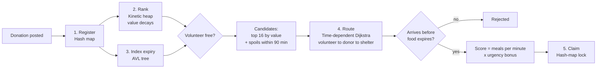

# Plate2Place

**Spoilage-aware surplus-food rescue dispatch for Bengaluru.**
An Advanced Data Structures & Algorithms project: a kinetic heap, an AVL tree, time-dependent Dijkstra, indexed heaps and hash maps, all written from scratch, with a Node.js backend and a live web frontend.

### 🔗 Live app: **https://plate-to-place.onrender.com/**

- API health check: https://plate-to-place.onrender.com/api/health
- The app runs on Render's free plan. If nobody has opened it for 15 minutes, the first visit takes about 50 seconds while the server wakes up.

---

## 1. The problem

Every night, Bengaluru's restaurants, wedding halls, hostels and office canteens throw away cooked food, while shelters a few kilometres away don't have enough. Volunteer groups coordinate rescues on WhatsApp: someone posts "40 meals at Indiranagar", and whoever sees it goes.

That approach misses three things:

- **Food has a deadline.** Cooked food is safe for only a few hours. A volunteer can cross the city and arrive after the food has spoiled.
- **Travel time depends on the hour.** The same trip can take 15 minutes at 23:00 and 50 minutes in the 19:00 rush.
- **Value changes every minute.** A 220-portion wedding surplus is the most valuable post at 20:00, but if it expires soon, a smaller post that lasts longer can be worth more an hour later.

**Plate2Place** decides which volunteer should collect which donation, and which shelter it should go to. It only sends a volunteer when the food will reach a shelter **before it spoils**.

---

## 2. What you see in the app

| Tab | What it shows | How to use it |
|---|---|---|
| **Live map** | A simulated evening, 18:00–02:30: 160 donations, 20 volunteers, 22 shelters on a Bengaluru road network | Press **Play**, or **Next event ›** to step through one decision at a time. The **What just happened** panel explains each event and which data structure handled it. |
| **Compare** | The same evening run with 3 dispatch methods | Read the 3 cards, then click **Run seeds 1–5** to test 5 more evenings on the backend |
| **Dispatch desk** | Real use by a coordinator | Click the map to post a donation or place a volunteer, then **Find best pickup**, **Assign**, **+30 min** |
| **Structures lab** | Each data structure on its own | Insert sorted keys into the BST and the AVL tree side by side; drag the kinetic-heap slider; read the benchmarks |
| **Method** | Problem, pseudocode and complexity tables | Reference material for the report |

---

## 3. How it works

Every donation goes through the same five steps:



### The value of a donation

A donation with **P** portions, safe life **L** minutes and expiry time **E** has this value at time **t**:

```
value(t) = P × (E − t) / L        → falls in a straight line, reaching 0 at expiry
```

### The decision rule

When a volunteer becomes free at time `t`:

1. **Gather candidates.** Take the 16 most valuable posts from the kinetic heap, plus every post the AVL tree says expires within 90 minutes. Skip posts already claimed (hash-map lookup).
2. **Route.** Run time-dependent Dijkstra from the volunteer to each donor, then from each donor to the nearest shelter that still has space, using this hour's travel times.
3. **Check feasibility.** Reject any trip that would deliver after the food expires.
4. **Score.**
```
   score = load / (minutes until delivery) × urgency
   urgency = 1 + 0.6 × max(0, 1 − slack / 90)      slack = expiry − delivery time
```
5. **Claim.** Pick the highest score and lock that donation in a hash map, so no second volunteer is sent.

---

## 4. The data structures

Each data structure is written from scratch in `engine/` and checked against a reference implementation in `tests/run.js`.

| Structure | File | Job | Cost |
|---|---|---|---|
| **Kinetic heap** | `engine/kinetic.js` | Keeps donations ordered by value while every value falls each minute. One *certificate* per parent–child pair; the heap only works when a certificate fails. | advance O(e log n), insert/remove O(log n), top O(1) |
| **AVL tree** | `engine/avl.js` | Indexes posts by `(expiry, id)`: "what spoils in the next 90 min?" and the expiry sweep | O(log n) insert/delete, O(log n + k) range |
| **Plain BST** | `engine/bst.js` | Baseline: sorted arrivals turn it into a linked list | O(n) worst case |
| **Graph + time-dependent Dijkstra** | `engine/graph.js` | Exact arrival times for this hour (FIFO congestion model) | O((V + E) log V) |
| **Indexed min-heap** | `engine/minheap.js` | Certificate queue, Dijkstra frontier, event loop | O(log n) |
| **Hash map** | `engine/hashmap.js` | Registry, claim locks, shelter capacity, heap positions | O(1) average |

**Kinetic heap certificate:** with `value(t) = a − b·t`, the time a parent is overtaken by its child is
```
fail time = (a_parent − a_child) / (b_parent − b_child)
```

**Why AVL and not a plain BST?** Donations arrive in time order, so expiry keys arrive almost sorted, which is the worst case for a BST. With 4,000 keys, the BST reaches height 3,967; the AVL tree stays at 12.

---

## 5. Worked example, step by step

The numbers come from the real engine. You can repeat this on the **Dispatch desk** tab.

### 20:00 — three donations are posted

| ID | Donor | Portions | Safe for | Expires | Value at 20:00 |
|---|---|---|---|---|---|
| L001 | Wedding hall, Koramangala | 220 | 170 min | **22:50** | 220 |
| L002 | Restaurant, Indiranagar | 40 | 55 min | **20:55** | 40 |
| L003 | Hostel mess, BTM Layout | 60 | 95 min | **21:35** | 60 |

Each post is stored in the **hash map**, inserted into the **kinetic heap** and indexed in the **AVL tree**.

- **Kinetic heap ranking:** L001 (220) › L003 (60) › L002 (40)
- **AVL query, "spoils within 60 min":** `[L002]`. Within 100 min: `[L002, L003]`

### A volunteer on a scooter (45 portions) becomes free at HSR Layout

**Time-dependent Dijkstra, both legs, at 20:00 traffic:**

| Post | Reach donor | Nearest shelter with space | Deliver by | Expires | Feasible? |
|---|---|---|---|---|---|
| L003 | 20:27 | Old-age home, JP Nagar | **20:46** | 21:35 | ✅ 49 min spare |
| L001 | 20:29 | Night shelter, BTM Layout | **20:40** | 22:50 | ✅ 130 min spare |
| L002 | 20:51 | Community kitchen, MG Road | **21:09** | 20:55 | ❌ 14 min too late |

L002 is **rejected**: even the fastest route reaches a shelter after the food has spoiled.

**Scoring:**

| Post | Load | Minutes | Slack | Urgency | Score |
|---|---|---|---|---|---|
| L003 | 45 | 46.1 | 49 min | **1.27** | 45 / 46.1 × 1.27 = **1.24** ← chosen |
| L001 | 45 | 39.8 | 130 min | 1.00 | 45 / 39.8 × 1.00 = **1.13** |

The scooter goes to **L003**, the hostel mess, because its food has much less time left. L003 is then locked in the hash map.

**With a car (180 portions)** the same rule picks **L001**: 180 / 39.8 = **4.52**.

### The kinetic heap reorders itself

| Post | Portions | Safe for | Value at 20:00 | Falls per minute |
|---|---|---|---|---|
| Hotel buffet | 120 | 60 min | 120 | 2.00 |
| Bakery | 80 | 240 min | 80 | 0.33 |

Certificate *"buffet ≥ bakery"* fails at **20:24**:

| Time | Buffet | Bakery | Top of heap |
|---|---|---|---|
| 20:00 | 120.0 | 80.0 | Buffet |
| 20:10 | 100.0 | 76.7 | Buffet (no work) |
| **20:24** | 72.0 | 72.0 | **one swap → Bakery** |
| 20:40 | 40.0 | 66.7 | Bakery (no work) |

Over 40 minutes the heap did **one** piece of work. Re-sorting every minute would have re-evaluated every post 40 times.

### The same steps through the live API

```bash
curl -X POST https://plate-to-place.onrender.com/api/live/donations \
  -H "Content-Type: application/json" \
  -d '{"donor":"Hostel mess, BTM Layout","lat":12.9166,"lng":77.6101,"portions":60,"lifeMinutes":95}'

curl -X POST https://plate-to-place.onrender.com/api/live/recommend \
  -H "Content-Type: application/json" \
  -d '{"lat":12.9116,"lng":77.6474,"cap":45}'

curl -X POST https://plate-to-place.onrender.com/api/live/claim \
  -H "Content-Type: application/json" -d '{"id":"L001","volunteer":"Asha"}'
```

`recommend` returns every candidate with `feasible`, `load`, `arriveDonor`, `deliverBy`, `shelter`, `score` and both routes. Times are minutes after midnight (1246 = 20:46). A second `claim` on the same id returns an error.

---

## 6. Results

Same city, donations and volunteers for every method (160 donations, 20 volunteers, average over 5 evenings):

| Method | Meals saved | Rescue rate | Wasted trips per night |
|---|---|---|---|
| First come, first served (WhatsApp today) | 2,921 | 29.3% | 14 |
| Nearest volunteer first | 6,424 | 64.4% | 3 |
| **Plate2Place** | **7,149** | **71.5%** | **0** |

| Benchmark | Result |
|---|---|
| BST vs AVL, 4,000 nearly sorted keys | height 3,967 vs 12; **181× fewer comparisons** |
| Kinetic heap vs re-sorting every minute | **≈350–520× less work** |

> The city layout and congestion pattern are modelled on Bengaluru; donors and shelters are generated, so results come from simulation.

---

## 7. API reference

Base URL: `https://plate-to-place.onrender.com`

| Method | Path | Input |
|---|---|---|
| GET | `/api/health` | |
| GET | `/api/run` | `?seed=7&donations=160&volunteers=20` |
| GET | `/api/compare` | `?seeds=1,2,3,4,5` |
| GET | `/api/bench/trees`, `/api/bench/kinetic` | |
| GET | `/api/live/state`, `/api/live/urgent?within=60` | |
| POST | `/api/live/donations` | `{donor, lat, lng, portions, lifeMinutes}` |
| POST | `/api/live/recommend` | `{lat, lng, cap}` |
| POST | `/api/live/claim` | `{id, volunteer}` |
| POST | `/api/live/complete` | `{id}` |
| POST | `/api/live/time` | `{t}` minutes after midnight |

---

## 8. Run it yourself

Needs Node.js 18 or later; no dependencies to install.

```bash
git clone https://github.com/rachelelizab/plate-to-place.git
cd plate-to-place
npm test        # 16 tests
npm run bench   # benchmark tables
npm run build
npm start       # http://localhost:3000
```

**Deploy on Render:** New → Web Service → this repo. Build `npm run build && npm test`, start `npm start`, instance type Free. Every `git push` redeploys.

---

## 9. Project structure

```
engine/        hashmap, minheap, bst, avl, kinetic, graph (Dijkstra),
               city (scenario), sim (3 strategies), live (dispatch desk), bench
server/        server.js: REST API + serves the frontend
frontend/      app.html, app.css, app.js → built into dist/
tests/         run.js: 16 tests
scripts/       build.js, bench-cli.js
DEMO.md        6-minute presentation script
```
